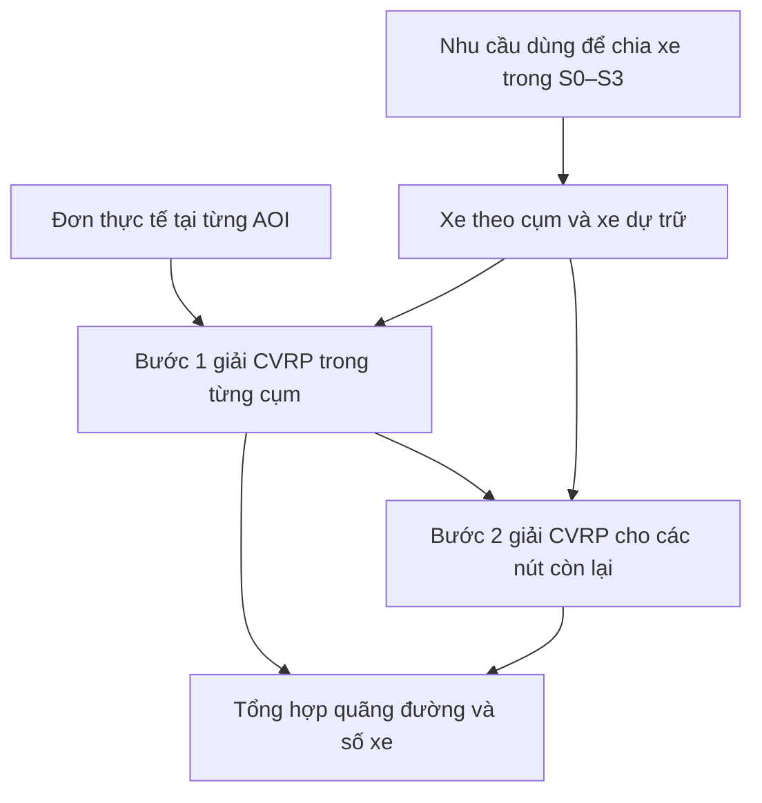

# Đề cương chi tiết MI3380

**Tên đề tài**  
Dự báo nhu cầu giao hàng theo cụm AOI và tối ưu tuyến phân phối chặng cuối bằng OR-Tools trên dữ liệu LaDe-D

**English title**  
Delivery Demand Forecasting by AOI Group and Last-Mile Route Optimization with OR-Tools on LaDe-D

## A. Mở đầu

### 1. Đặt vấn đề

Đội giao hàng phải quyết định phân bổ xe trước khi biết đầy đủ số đơn trong ngày. Nếu chia xe đều, vùng nhiều đơn có thể phải vay thêm xe trong khi vùng khác còn xe trống. Đề tài dự báo số đơn tiếp nhận trước một ngày, dùng dự báo để phân bổ xe, rồi lập tuyến từ các đơn thực tế bằng OR-Tools. Hai bước được đánh giá riêng để xem sai số dự báo ảnh hưởng thế nào đến quãng đường, số xe vay thêm và số xe nhàn rỗi.

### 2. Tổng quan nghiên cứu

Baseline lịch sử là mốc so sánh cho dự báo chuỗi theo thời gian. LightGBM và XGBoost là hai phương pháp gradient boosting được thử với cùng tập đặc trưng thời gian, độ trễ và không gian. Ở bước lập tuyến, bài toán CVRP (Capacitated Vehicle Routing Problem) thêm ràng buộc tải trọng vào việc phân điểm giao cho các xe. Cách tiếp cận *predict, then optimize* đánh giá cả sai số dự báo lẫn chi phí của quyết định dùng dự báo. LaDe-D Jilin cung cấp dữ liệu để thử quy trình này trên cùng một tập đơn. Các tài liệu nền được liệt kê ở mục D.

### 3. Mục tiêu và câu hỏi nghiên cứu

Mục tiêu tổng quát là đánh giá liệu phân bổ xe theo nhu cầu dự báo có cải thiện vận hành so với chia đều, và khoảng cách còn lại so với phương án biết trước nhu cầu là bao nhiêu.

| Câu hỏi | Nội dung |
|---|---|
| RQ1 | LightGBM và XGBoost dự báo số đơn theo vùng × loại AOI × ngày có tốt hơn các baseline lịch sử không? |
| RQ2 | Các nhóm đặc trưng lịch, lag, rolling và không gian đóng góp thế nào vào chất lượng dự báo? |
| RQ3 | Khi dùng dự báo để chia xe, tổng quãng đường, số xe vay thêm và số xe nhàn rỗi thay đổi thế nào so với chia đều? |
| RQ4 | Kết quả phân bổ theo dự báo còn cách kịch bản Oracle bao xa? |

### 4. Đối tượng và đơn vị phân tích

Đối tượng nghiên cứu là mối liên hệ giữa sai số dự báo và hiệu quả phân bổ xe, định tuyến. Khách thể là các đơn giao trong tập LaDe-D Jilin. Một dòng dự báo ứng với `region_id × aoi_type × ngày`. Bảng `aoi_id × ngày` cung cấp nhu cầu thực tế ở nút CVRP. Đơn vị phân bổ xe có thể là vùng được mã hóa trong dữ liệu (`region_id`) hoặc cụm địa lý của các AOI, tùy kết quả kiểm tra phân bố trên tập train.

### 5. Phạm vi

- Dữ liệu Jilin có ngày từ 12/05 đến 28/10. Thực nghiệm chính dùng 27/06–02/10 và dùng toàn kỳ cho phân tích độ nhạy. Năm 2022 là quy ước xử lý vì dữ liệu nguồn thiếu thông tin năm.
- Biến mục tiêu là **số đơn tiếp nhận theo `ds`**. Giữ đủ 41 chuỗi vùng × loại AOI, kể cả các chuỗi thưa. Dự báo trực tiếp cho từng AOI là hướng mở rộng.
- Thiết kế định tuyến dùng một depot, đội xe đồng nhất và ràng buộc tải trọng. Khoảng cách Haversine là xấp xỉ theo tọa độ, còn thời gian giao, cửa sổ thời gian và định tuyến động nằm ngoài phạm vi.

### 6. Phương pháp và thiết kế thực nghiệm

Đề tài dùng EDA để kiểm tra chất lượng dữ liệu, thực nghiệm dự báo để so sánh mô hình và mô phỏng bốn kịch bản phân bổ trên cùng tập đơn thực tế.

#### 6.1. Dự báo nhu cầu

Tọa độ giữ chỗ gần (0, 0) được chuyển thành giá trị thiếu. Loại các đơn giao trên 24 giờ khỏi tập phân tích và ghi lại từng đơn trong nhật ký. Phân tích độ nhạy giữ đủ đơn giúp đánh giá mức ảnh hưởng của quy tắc lọc hồi cứu này. Trên lịch ngày đầy đủ, một chuỗi nhận giá trị 0 khi có dữ liệu tại thành phố nhưng chuỗi đó không phát sinh đơn. Ngày thiếu bản ghi trên toàn thành phố được giữ là chưa quan sát trong nhãn, lag và rolling.

| Nhóm đặc trưng | Cách tính |
|---|---|
| Lịch | Thứ trong tuần, ngày trong tháng, tháng và cờ cuối tuần theo năm giả định |
| Lag | Nhu cầu cách ngày dự báo 1, 7 và 14 ngày |
| Rolling | Trung bình và độ lệch chuẩn trong 7 và 14 ngày, tính đến hết ngày trước dự báo |
| Không gian | Mã vùng, loại AOI, tâm của các AOI trong chuỗi và mật độ đơn lịch sử |

Thống kê không gian của một dòng train chỉ dùng đơn trước thời điểm của dòng đó. Validation dùng bảng tra cố định ở cuối tập train. Khi thiếu thống kê chuỗi, dùng thống kê vùng, rồi đến toàn bộ lịch sử train. Mật độ được tính theo đơn trên mỗi AOI mỗi ngày quan sát. Với AOI xuất hiện ở nhiều vùng, giữ nhu cầu theo vùng gốc của từng đơn. Bảng tra AOI toàn kỳ dùng cho mô tả, còn việc phân bổ và xử lý AOI mới cần quy tắc được xác định từ train. [Thiết kế đặc trưng không gian](../docs/spatial_ml_design.md)

| Cửa sổ | Train | Validation | Test |
|---|---|---|---|
| Ổn định | 27/06–23/08 | 24/08–12/09 | 13/09–02/10 |
| Toàn kỳ | 12/05–21/08 | 22/08–24/09 | 25/09–28/10 |

Chia tập theo thứ tự thời gian. Giữ 14 ngày đầu của cửa sổ chính để khởi tạo lịch sử, còn 44 ngày train đủ đặc trưng. Cửa sổ ổn định được chọn từ EDA toàn kỳ nên mang tính hồi cứu. Khi báo cáo cửa sổ toàn kỳ, ghi kèm số ngày có quan sát và đủ dữ liệu lịch sử để chấm.

Các baseline gồm giá trị ngày trước, cùng ngày tuần trước, trung bình trượt 7/14 ngày, trung bình lịch sử và trung bình lịch sử cùng thứ. LightGBM và XGBoost học chung trên tất cả chuỗi. Chọn cấu hình bằng WAPE cấp chuỗi trên validation, rồi dùng MAE để phân hạng khi WAPE bằng nhau. Đánh giá theo giao thức *rolling one-day-ahead*, nghĩa là khi dự báo ngày $t$, nhu cầu quan sát đến hết ngày $t-1$ đã có sẵn.

Với $n$ quan sát, $y_i$ là số đơn thực tế và $\hat y_i$ là số đơn dự báo:

$$
\mathrm{MAE}=\frac{1}{n}\sum_{i=1}^n |y_i-\hat y_i|,
\quad \mathrm{RMSE}=\sqrt{\frac{1}{n}\sum_{i=1}^n (y_i-\hat y_i)^2},
\quad \mathrm{WAPE}=\frac{\sum_{i=1}^n |y_i-\hat y_i|}{\sum_{i=1}^n y_i}.
$$

Chấm theo chuỗi và sau khi cộng theo vùng–ngày. WAPE chỉ có nghĩa khi tổng số đơn thực tế dương. Để trả lời RQ2, so sánh mô hình đầy đủ với các lần bỏ từng nhóm đặc trưng. Phân tích thêm sai số ở nhóm nhu cầu thấp, vừa và cao, với ngưỡng phân nhóm xác định trên train.

#### 6.2. Phân bổ xe và tối ưu tuyến

Gọi $F$ là số xe sẵn có, $Q$ là tải trọng mỗi xe tính bằng đơn/ngày, $G$ là số cụm phân bổ với $G\le F$. Dùng vùng nếu dữ liệu địa lý và ánh xạ AOI phù hợp. Nếu cần phân cụm riêng, dùng K-means trên tâm AOI và xác định quy tắc gán AOI mới từ train. Các giá trị khởi điểm trong đề cương là $F=20$ và $Q=100$. Hiệu chỉnh trên train để sản lượng bình quân ngày đạt khoảng 80–90% công suất $FQ$ rồi ghi lại cấu hình trước khi chạy test.

Xác định một depot chung từ dữ liệu train. Lựa chọn mặc định là tâm tọa độ AOI có trọng số theo nhu cầu. Nếu chất lượng tọa độ không đủ, dùng vị trí AOI có nhu cầu train cao nhất trong các AOI có tọa độ hợp lệ.

Gọi $D_g$ là nhu cầu ước lượng của cụm $g$. Số xe ước lượng là $r_g=\lceil D_g/Q\rceil$. Khi $\sum_g r_g\le F$, gán $n_g=r_g$ và giữ $R=F-\sum_g n_g$ xe dự trữ dùng chung. Khi $\sum_g r_g>F$, phân $F$ xe theo tỷ lệ $r_g$ bằng phương pháp phần dư lớn nhất, khi đó $R=0$. S0 dùng quy tắc chia đều riêng.

| Kịch bản | Dữ liệu dùng khi phân bổ xe |
|---|---|
| S0 · Uniform | Chia đều $F$ xe cho $G$ cụm |
| S1 · Historical | Dùng trung bình cùng thứ trong tập train, kể cả khi một baseline khác cho sai số dự báo thấp hơn |
| S2 · Predicted | Dùng mô hình được chọn trên validation. Nếu cụm trùng vùng, cộng các loại AOI theo vùng. Nếu dùng cụm riêng, phân bổ dự báo xuống AOI theo tỷ lệ đơn train rồi cộng lại theo cụm |
| S3 · Oracle | Dùng nhu cầu thực tế của ngày đánh giá để làm mốc biết trước nhu cầu |

Cả bốn kịch bản giải CVRP trên cùng nhu cầu thực tế của ngày đánh giá. Một AOI có tải $q_i>Q$ được tách thành các nút đồng vị trí, mỗi nút tối đa $Q$ đơn. Bước 1 giải riêng từng cụm với $n_g$ xe và cho phép bỏ nút kèm chi phí phạt. Bước 2 gộp các nút còn lại, dùng xe dự trữ trước và tính số xe vay thêm từ số tuyến vượt dự trữ.

Trong phát biểu hai chỉ số, depot có chỉ số 0, $N$ là tập nút khách, $K$ là số xe tối đa và $x_{ij}$ cho biết có đi trực tiếp từ $i$ đến $j$ hay không. Với $d_{ij}$ là khoảng cách Haversine, CVRP phục vụ toàn bộ nút có dạng:

$$
\begin{aligned}
\min_x\quad &\sum_{i\ne j}d_{ij}x_{ij}\\
\text{với}\quad &\sum_{j\ne i}x_{ij}=1,\quad \sum_{j\ne i}x_{ji}=1 && (i\in N),\\
&\sum_{j\in N}x_{0j}=\sum_{i\in N}x_{i0}\le K,\\
&\sum_{i\in S}\sum_{j\in S,\; j\ne i}x_{ij}
\le |S|-\left\lceil\frac{\sum_{i\in S}q_i}{Q}\right\rceil
&& (\varnothing\ne S\subseteq N),\\
&x_{ij}\in\{0,1\}.
\end{aligned}
$$

OR-Tools sẽ dùng chiều tải trọng để kiểm soát tải xe. Khi cho phép bỏ nút ở bước 1, cần ghi quy tắc phạt, giới hạn giải và cách xử lý nút còn lại. Chốt depot, ánh xạ AOI, tải trọng, chiến lược nghiệm ban đầu, thiết lập tìm kiếm và điều kiện dừng qua thử nghiệm validation trước khi đánh giá trên test.

#### 6.3. Chỉ số vận hành dự kiến

| Ký hiệu | Cách đo |
|---|---|
| $L$ | Tổng quãng đường hai bước giải, tính bằng km |
| $B$ | Số xe vay thêm, $\max(0,v_2-R)$ với $v_2$ là số tuyến của bước 2 |
| $U$ | Số xe phân bổ cho các cụm nhưng không chạy tuyến ở bước 1 |
| $C_\lambda$ | Chi phí quy đổi $L+\lambda B$. Mức cơ sở $\lambda=50$ km/xe, kiểm tra độ nhạy với 0, 25, 50 và 100 km/xe |

Tính các chỉ số theo ngày, rồi cộng trên cùng tập ngày test. Với chỉ số chi phí $M\in\{L,B,C_\lambda\}$, phần khoảng cách đến Oracle được thu hẹp là

$$
\mathrm{GapClosed}(M)=\frac{M_{S0}-M_{S2}}{M_{S0}-M_{S3}}.
$$

Khi mẫu số đủ lớn, giá trị gần 1 cho thấy S2 gần S3, gần 0 cho thấy S2 gần S0 và giá trị âm cho thấy S2 kém hơn S0. Nếu $M_{S0}-M_{S3}<\varepsilon$, báo cáo hiệu số gốc và để trống tỷ lệ. Giá trị $\varepsilon$ sẽ được ghi trong cấu hình thực nghiệm.

## B. Nội dung báo cáo

### Chương 1. Cơ sở lý luận

1. Bối cảnh giao hàng chặng cuối, AOI, vùng và năng lực xe.
2. Dự báo nhu cầu theo không gian–thời gian, các baseline, gradient boosting và cách tránh rò rỉ khi tạo đặc trưng.
3. CVRP, kiểm soát tải trọng, heuristic, metaheuristic và các thành phần của OR-Tools dự kiến dùng.
4. Tích hợp dự báo với quyết định phân bổ và vai trò của Oracle trong đánh giá.

### Chương 2. Dữ liệu Jilin và thực nghiệm dự báo

1. Nguồn dữ liệu, trường địa lý và thời gian, bản ghi thiếu và ngoại lệ.
2. Phân bố nhu cầu theo thời gian và AOI, độ thưa của chuỗi, chọn cửa sổ ổn định và kiểm tra độ nhạy.
3. Xây bảng nhu cầu, tạo đặc trưng, chia tập và thiết lập so sánh.
4. Kết quả MAE, RMSE, WAPE, importance, ablation và sai số theo nhóm nhu cầu để trả lời RQ1–RQ2.

### Chương 3. Phân bổ xe và tối ưu tuyến

1. Chuyển dự báo theo chuỗi sang nhu cầu theo cụm. Hiệu chỉnh $F$, $Q$, $G$ và depot từ train.
2. Dùng ma trận Haversine, phân bổ xe và giải CVRP hai bước. Chạy S0–S3 trên cùng ngày, cùng depot và cùng quy tắc phân cụm.
3. Báo cáo $L$, $B$, $U$, $C_\lambda$, số xe sử dụng, thời gian giải và Gap closed. Phân tích độ nhạy theo $\lambda$ và sai số dự báo để trả lời RQ3–RQ4.
4. Thảo luận điều kiện dùng dự báo để phân bổ trước ca, cùng các giới hạn của dữ liệu và thiết kế một depot.

## C. Tiến độ và kế hoạch

EDA, bảng đặc trưng, baseline, đánh giá LightGBM và XGBoost trên validation, cùng demo dự báo đã có trong repo. Trên cửa sổ chính, WAPE cấp chuỗi của trung bình trượt 7 ngày, LightGBM và XGBoost lần lượt là **21,22%**, **24,87%** và **25,98%** trên validation. Baseline trung bình trượt 7 ngày đạt **22,73%** trên test. Kết quả test của hai mô hình ML và kết quả S0–S3 sẽ được bổ sung khi có thực nghiệm tương ứng. [Kết quả dự báo](../docs/ml_validation_results.md)

| Tuần theo kế hoạch học phần | Công việc | Đầu ra |
|---|---|---|
| 10 | Chốt đề cương, đọc LaDe và tài liệu nền, dựng repo | Đề cương, dữ liệu nguồn và repo |
| 11 | EDA, làm sạch, lập bảng nhu cầu, khảo sát cụm và tải trọng | Notebook EDA và bảng nhu cầu |
| 12 | Tạo đặc trưng, chia tập và chạy baseline | Pipeline và bảng điểm baseline |
| 13 | Huấn luyện LightGBM/XGBoost, phân tích importance, ablation, chuẩn bị đầu vào định tuyến | Kết quả dự báo và bản nháp Chương 2 |
| 14 | Cài phân bổ xe và CVRP hai bước, chạy thử S0–S3 trên mẫu | Mô phỏng thử nghiệm |
| 15 | Tuần đệm. Chạy mẫu validation, chốt cấu hình rồi chạy test và độ nhạy | Bảng chỉ số S0–S3 |
| 16 | Viết các chương, bổ sung hình bảng và phụ lục | Bản nháp báo cáo |
| 17 | Sửa theo góp ý, đối chiếu kết quả với repo, kiểm tra trích dẫn | Báo cáo và repo bản nộp |

| Rủi ro | Cách xử lý |
|---|---|
| Nhu cầu từng AOI quá thưa | Dự báo ở cấp vùng × loại AOI và giữ các chuỗi thưa để đánh giá |
| Giải CVRP quá chậm | Giới hạn thời gian giải và chạy thử trên mẫu ngày hoặc mẫu AOI |
| Bước 2 ít phát sinh | Kiểm tra mức sử dụng công suất trên train trước khi cố định $F$ và $Q$ |
| S2 kém hơn S0 | Báo cáo nguyên kết quả và phân tích các ngày hoặc vùng có sai lệch lớn |
| Chậm tiến độ | Dùng tuần đệm và giảm số thí nghiệm phụ để giữ so sánh S0–S3 trên cùng mẫu |

Phần kết luận sẽ trả lời từng RQ theo kết quả thực nghiệm. Đề xuất áp dụng chỉ khi có bằng chứng cải thiện chỉ số vận hành. Các hướng mở rộng gồm khoảng cách đường bộ, cửa sổ thời gian, nhiều depot, thêm thành phố, dữ liệu thời tiết và *decision-focused learning*.

## D. Tài liệu tham khảo

1. Chen, T. & Guestrin, C. (2016). *XGBoost: A Scalable Tree Boosting System*. Proceedings of the 22nd ACM SIGKDD International Conference on Knowledge Discovery and Data Mining.
2. Elmachtoub, A. N. & Grigas, P. (2022). *Smart “Predict, then Optimize”*. Management Science.
3. Google. *OR-Tools Vehicle Routing*. [Tài liệu OR-Tools](https://developers.google.com/optimization/routing)
4. Ke, G. và cộng sự (2017). *LightGBM: A Highly Efficient Gradient Boosting Decision Tree*. Advances in Neural Information Processing Systems 30.
5. Toth, P. & Vigo, D. (2014). *Vehicle Routing: Problems, Methods, and Applications*. Ấn bản thứ 2, SIAM.
6. Wu, L. và cộng sự (2023). *LaDe: The First Comprehensive Last-mile Delivery Dataset from Industry*. arXiv:2306.10675. [Bản PDF trong repo](lade_paper_2306.10675v3.pdf)

## E. Phụ lục và tái lập

1. [Notebook EDA](../notebooks/01_eda.ipynb) và [kiểm tra bảng nhu cầu](../data/processed/panel_audit.json).
2. [Danh sách đặc trưng](../configs/forecast_features.json), [thiết lập ML](../configs/ml_experiment.json) và [bảng dự báo demo](../outputs/forecasts/demo/forecast_jilin_predictions.csv).
3. Dự kiến bổ sung cấu hình OR-Tools đã chốt và kết quả chi tiết S0–S3.
4. [Hướng dẫn chạy lại và cấu trúc repo](../README.md).
